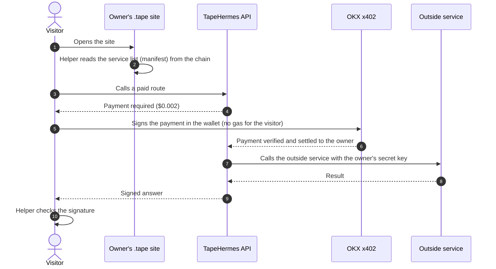

<div align="center">

# TapeHermes

### A backend for TapeOut websites. No server to run.

Store secret API keys, define what your site may call, and earn per call in USDT on X Layer.
Every answer is signed, so visitors can prove it came from your site.

<br />

[](#hackathon)

[-111827?style=flat-square)](https://web3.okx.com/xlayer)
[](https://web3.okx.com)
[](https://web3.okx.com/xlayer)
[-6d28d9?style=flat-square)](https://26-2-2.tapekit.org/)
[-0369a1?style=flat-square)](#signed-answers)
[](https://github.com/devfreeguy/tapehermes/actions/workflows/deploy-production.yml)

[](https://nestjs.com)
[](https://nodejs.org)
[](https://www.typescriptlang.org)
[](https://nextjs.org)
[](https://www.prisma.io)
[](https://www.postgresql.org)
[](https://redis.io)

<br />

[**Live demo site**](https://26-2-2.tapekit.org/) &nbsp;|&nbsp;
[**Owner dashboard**](https://dashboard.tapehermes.xyz) &nbsp;|&nbsp;
[**API**](https://api.tapehermes.xyz/health) &nbsp;|&nbsp;
[**X / Twitter**](https://x.com/TapeHermes)

</div>

---

## Contents

- [What it is](#what-it-is)
- [The problem](#the-problem)
- [How it works](#how-it-works)
- [Try it in two minutes](#try-it-in-two-minutes)
- [Features](#features)
- [Signed answers](#signed-answers)
- [Safety rules](#safety-rules)
- [Architecture](#architecture)
- [Run it yourself](#run-it-yourself)
- [Project layout](#project-layout)
- [Tests](#tests)
- [Deployment](#deployment)
- [Hackathon](#hackathon)

---

## What it is

TapeHermes is a hosted backend for [TapeOut](https://26-2-2.tapekit.org/) websites on X Layer.

A TapeOut site lives fully on chain. That makes it permanent and public, but it also means it is a plain static page. It cannot keep a secret, cannot call an outside service that needs an API key, and cannot charge anyone.

TapeHermes fills that gap:

1. The **owner** connects their site and saves their secret API keys with TapeHermes.
2. The owner sets up **routes**: which outside service a call may reach, which inputs a visitor may change, which fields come back, and a **price in USD**.
3. A **visitor** on the owner's site makes a call. A paid call is settled in USDT0 straight to the owner's wallet.
4. TapeHermes runs the call with the secret key and returns a **signed answer**.

The owner runs no server and writes no code. Routes are settings only.

## The problem

| Without TapeHermes | With TapeHermes |
|---|---|
| A static on-chain site cannot hold an API key. | Keys are stored encrypted. They are never shown again and never sent to the browser. |
| Calling a paid outside service needs a server. | TapeHermes makes the call for the site. |
| No way to charge visitors per use. | Pay per call in USDT0 through OKX x402. The money goes directly to the owner. |
| Visitors cannot tell if an answer is real. | Every answer is signed with the site's own key and checked in the browser. |

## How it works



**For the owner:** connect a wallet, add the site, add a secret, create a route, sign one delegation, publish the manifest. Full steps are in [Try it in two minutes](#try-it-in-two-minutes).

**For the visitor:** open the site, press a button, sign the payment in the wallet (free, no gas), read the answer.

## Try it in two minutes

You do not need to install anything.

1. Open the live demo site: **<https://26-2-2.tapekit.org/>**. A second page with the full playground is at <https://26-2-2.tapekit.org/playground.html>.
2. Use the language switch (English or Chinese) if you like.
3. **Free call:** pick a free route and send it.
4. **Paid call:** connect a wallet that holds a little USDT0 on X Layer (chain 196), pick a paid route and send it. Sign the payment in the wallet. Paying costs the visitor no gas.
5. Look at the answer. The page shows the checks that prove the answer is signed by the site.
6. Open the [owner dashboard](https://dashboard.tapehermes.xyz) to see how the owner sets all of this up.

## Features

**For site owners (dashboard)**

- Wallet sign-in. No password or email.
- Site ownership is proven by reading the chain: the signed-in wallet must hold the site.
- Guided setup that explains each step in plain language.
- Secret key safe. Values are encrypted, shown once, never logged.
- Routes by settings only, with a USD price per call and per-route limits.
- A signed delegation lets TapeHermes answer for the site until an expiry date the owner chooses.
- One-click manifest publishing. The manifest tells visitors which routes exist and what they cost.
- Website tab: publish the site's own files to X Layer from the same dashboard.
- Call log per route: time, result, paid or free, payment transaction, duration. No visitor personal data.
- English and Simplified Chinese.

**For visitors (public site and helper file)**

- Pay per call with a wallet. The visitor pays no gas.
- Free routes with rate limits.
- Signature check in the browser, with a tamper test.
- Request trace and activity log on the playground page.

**Under the hood**

- OKX x402 `exact` scheme on X Layer mainnet, USDT0 (6 decimals).
- Strict outside-call rules (see [Safety rules](#safety-rules)).
- Multi-node chain reads across independent operators.

## Signed answers

Every answer carries a signature made with the site's signing key (TAP-13). The signing key holds no funds. The owner authorises it with a delegation signed by the owner's own wallet, and that delegation is published in the manifest on chain. A browser can therefore check, without trusting TapeHermes:

1. The manifest on chain names the site's signer.
2. The owner's wallet signed the delegation, and it has not expired.
3. The signer signed this exact answer.

If any byte of the answer changes, the check fails. The playground page has a button that tampers with an answer so you can see this fail.

## Safety rules

The worker that calls outside services follows fixed rules that an owner cannot loosen:

- `https` only
- At most 3 outside hosts per site
- No redirects
- 256 KB response cap
- Private and internal addresses are blocked
- Secrets are encrypted with AES-256-GCM, never shown after saving, never logged
- Visitor IP addresses are hashed with a salt for rate limits and are not stored in the database
- The server refuses to start if any setting still holds a placeholder such as `CHANGE_ME`

## Architecture

| Part | What it does | Technology |
|---|---|---|
| `src/` | Backend API: sign-in, sites, secrets, routes, payments, signing, call log | NestJS 12 (ES modules), Express 5, TypeScript, zod |
| `prisma/` | Data model and migrations | Prisma 7, PostgreSQL |
| Redis | One-time sign-in messages, rate limits, short caches | ioredis |
| `dashboard/` | Owner dashboard | Next.js 16, React 19, wagmi, viem, shadcn/ui |
| `helper/` | One browser file for TapeOut sites: reads the manifest, handles the payment retry, checks signatures | Plain JavaScript (built with esbuild) |
| `public-site/` | The demo site published to `26.2.2.tape`: landing page and playground | Plain HTML, CSS and JS, no framework |
| `vendor/` | `@tapeapi/sdk` and `@tapeapi/server` 3.0.0 (MIT) | Local tarballs |
| `deploy/` | Production compose file and scripts | Docker, GitHub Actions |

**Production:** the API runs at `api.tapehermes.xyz` (container on a server behind Caddy), the dashboard at `dashboard.tapehermes.xyz` (Vercel), and the demo site on X Layer, served by the TapeOut gateway.

**On-chain facts**

| | |
|---|---|
| Chain | X Layer mainnet, chain ID 196 |
| Payment token | USDT0 `0x779ded0c9e1022225f8e0630b35a9b54be713736` |
| Site registry | `0xd6EFb7adCc9c83dC4924Ad56f6a8E4e969b9ADB6` |
| Demo site | `26.2.2.tape` (container `0x5181bc4ee9ff92f63c060059826eb100c32c2aa8`) |

## Run it yourself

**You need:** Node.js 22.12 or newer, [pnpm](https://pnpm.io), and Docker (for Postgres and Redis).

### 1. Install

```bash
git clone https://github.com/devfreeguy/tapehermes.git
cd tapehermes
pnpm install
```

### 2. Start the database and Redis

```bash
pnpm services:up
```

This starts Postgres on `127.0.0.1:5433` and Redis on `127.0.0.1:6380`.

### 3. Configure

```bash
cp .env.example .env
```

Open `.env` and fill it in. The important settings:

| Setting | What to put |
|---|---|
| `RPC_URLS_196` | Comma-separated X Layer RPC URLs from at least two independent operators |
| `DATABASE_URL`, `REDIS_URL` | The local services from step 2 |
| `VAULT_MASTER_KEY` | 32 random bytes in base64: `node -e "console.log(require('crypto').randomBytes(32).toString('base64'))"` |
| `RATE_LIMIT_SALT` | Any long random string |
| `AUTH_DOMAIN` | The domain the owner signs in from, for example `localhost:3001` |
| `PUBLIC_BASE_URL` | The public address of this API |
| `X402_NETWORK` | `eip155:196` for mainnet, `eip155:1952` for testnet |
| `OKX_API_KEY`, `OKX_SECRET_KEY`, `OKX_PASSPHRASE` | Your OKX credentials for x402 (needed for paid routes) |

Never commit `.env`. Every value in it is yours alone. `VAULT_MASTER_KEY` encrypts every stored secret and signing key: if you lose it, they cannot be recovered.

### 4. Create the tables and start the API

```bash
pnpm db:migrate
pnpm start
```

The API listens on `PORT`. Check it:

```bash
curl http://localhost:<PORT>/health
# {"ok":true,"database":"up","redis":"up"}
```

### 5. Start the dashboard

```bash
cd dashboard
pnpm install
```

Create `dashboard/.env.local` and point the dashboard at your API:

```bash
NEXT_PUBLIC_API_URL=http://localhost:<PORT>
```

```bash
pnpm dev
```

Open <http://localhost:3001>.

### 6. Preview the public site

```bash
pnpm site:build   # builds the helper and the site bundle
pnpm site:dev     # local preview
```

`pnpm site:build` also writes `public-site/dist/site-bundle.json`. Choose that file in the dashboard's **Website** tab to publish the site to X Layer.

## Project layout

```text
tapehermes/
  src/            Backend API (NestJS)
    auth/         Wallet sign-in
    sites/        Site ownership and signing keys
    secrets/      Encrypted key safe
    routes/       Settings-only routes and prices
    payments/     OKX x402 paid calls
    signing/      Signed answers
    manifest/     Service manifest building and publishing
    site-files/   Plans for publishing site files to X Layer
    worker/       Outside calls under strict rules
    logs/         Call log
  prisma/         Schema and migrations
  dashboard/      Owner dashboard (Next.js)
  helper/         Browser helper file for TapeOut sites
  public-site/    The demo site published to 26.2.2.tape
  proofs/         Small scripts that prove each risky idea on the real chain
  deploy/         Production deployment
  docs/PRD.md     Product requirements
  test/           Backend tests
```

## Tests

```bash
pnpm typecheck        # types for the backend
pnpm test             # backend tests (need Postgres and Redis: pnpm services:up)
pnpm --dir dashboard test   # dashboard tests
pnpm --dir public-site test # public site tests
```

The `proofs/` folder holds numbered scripts (`pnpm proof:1` and so on). Each one checks a single risky assumption, such as signing an answer on chain 196 or a fresh wallet paying with no gas.

## Deployment

Pushing to `main` runs `.github/workflows/deploy-production.yml`: verify, build images for amd64 and arm64, push, deploy over SSH, and record the new image only after the health check passes. The dashboard deploys to Vercel from the same push. See [`deploy/README.md`](deploy/README.md) for first-time server setup.

## Hackathon

TapeHermes is built for the **TapeOut Genesis Transistor Hackathon**.

| | |
|---|---|
| Project | TapeHermes |
| Demo site | <https://26-2-2.tapekit.org/> |
| Dashboard | <https://dashboard.tapehermes.xyz> |
| Social | <https://x.com/TapeHermes> |
| Product spec | [`docs/PRD.md`](docs/PRD.md) |

Billing of owners is free during the hackathon. Payments go straight from the visitor to the owner. TapeHermes never holds funds.

---

<div align="center">

Built on X Layer with OKX x402 and TapeOut.

</div>
